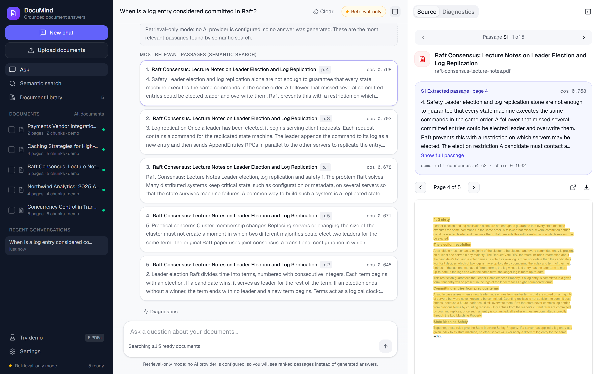
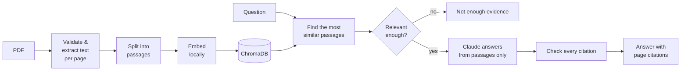
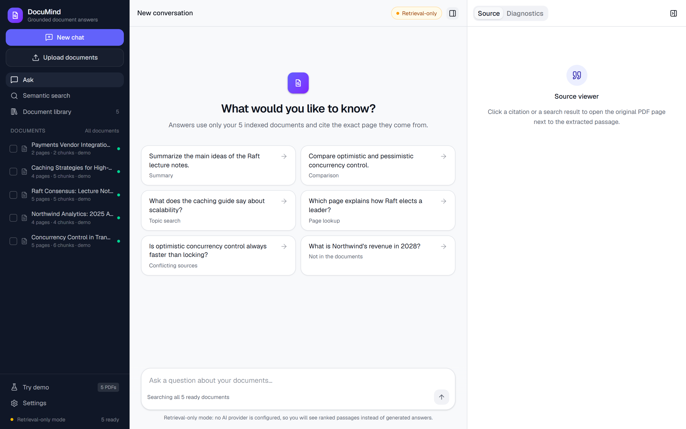
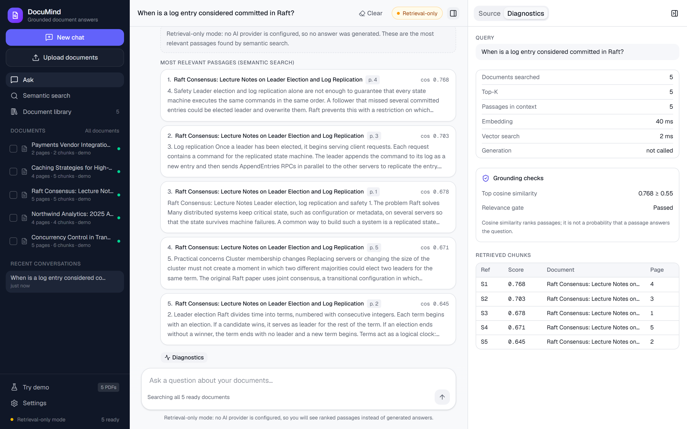
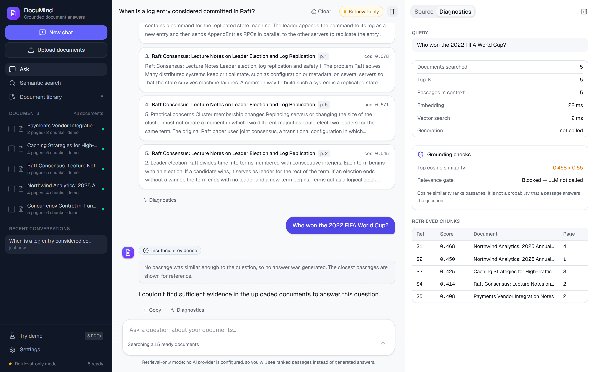
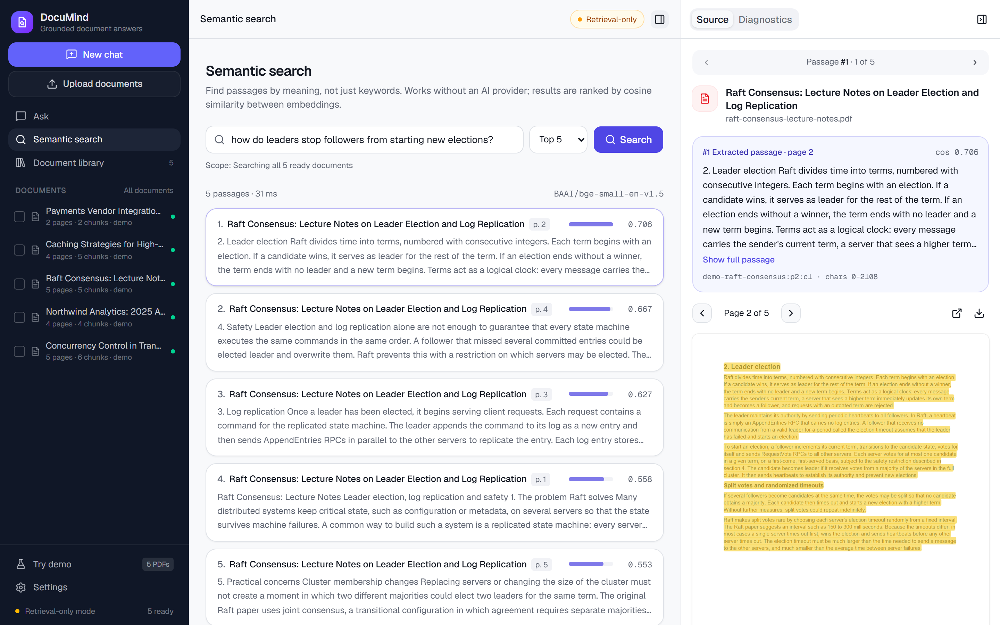
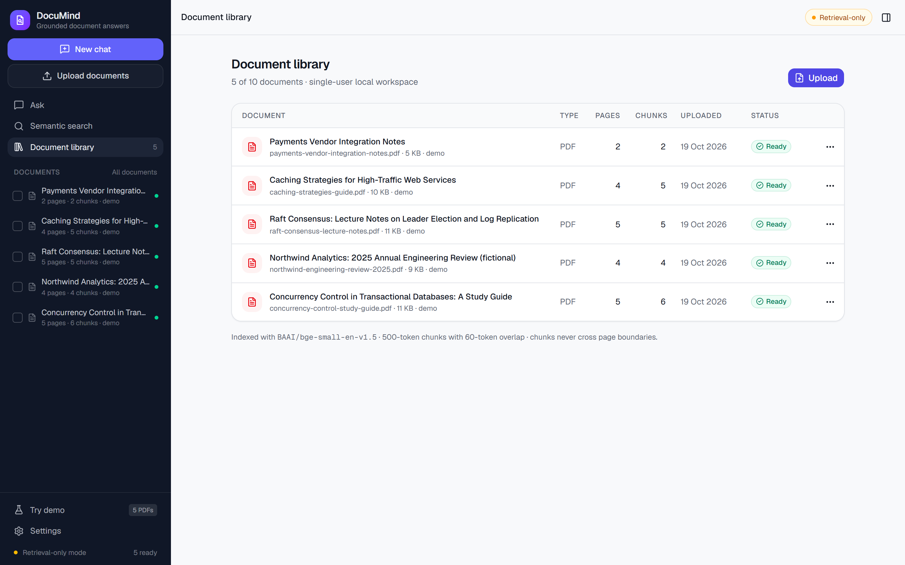
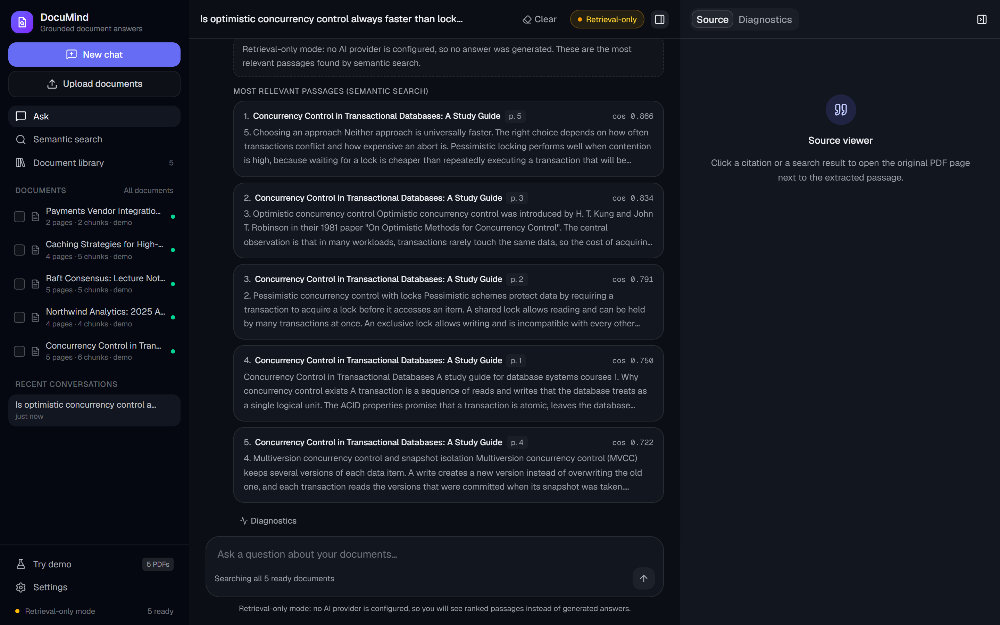

# DocuMind

**Ask questions about your PDFs. Every answer cites the document and page it came from, and when the answer
isn't in your documents, DocuMind says so instead of guessing.**

[](https://github.com/mariusgreiersen/documind-rag-assistant/actions/workflows/ci.yml)




## What it does

- **Upload PDFs** and search them by meaning, not just keywords.
- **Ask questions** and get answers grounded in your documents, with clickable citations that open the exact page.
- **Refuses to make things up.** If the documents don't contain the answer, you get "I couldn't find sufficient
  evidence" instead of a confident guess.
- **Works without an API key.** Search and the PDF viewer run on a free local model. Generated answers need a
  Claude API key.
- **Measures its own quality** with a 36-question benchmark and standard retrieval metrics.

Built with **FastAPI**, **ChromaDB**, **Sentence Transformers**, the **Claude API**, **React + TypeScript** and
**Docker**. The retrieval-augmented generation (RAG) pipeline is written explicitly, without LangChain, so every
step is visible and tested.

## Quick start

You need [Docker](https://docs.docker.com/get-docker/).

```bash
git clone https://github.com/mariusgreiersen/documind-rag-assistant.git
cd documind-rag-assistant
cp .env.example .env        # optional: set LLM_API_KEY to enable generated answers
docker compose up --build
```

Then open **http://localhost:8080**. Five sample documents are loaded automatically.

| What | Where |
|---|---|
| App | http://localhost:8080 |
| API docs (Swagger) | http://localhost:8000/docs |

The first build takes a few minutes: it installs PyTorch (CPU) and bakes the embedding model into the image.

<details>
<summary><b>Run without Docker</b> (Python 3.11+, Node 22+)</summary>

```bash
# Backend
cd backend
python -m venv .venv
source .venv/bin/activate                  # Windows: .venv\Scripts\activate
pip install torch --index-url https://download.pytorch.org/whl/cpu
pip install -e ".[dev]"
python -m documind.cli seed-demo           # index the sample PDFs
uvicorn documind.main:app --reload         # http://localhost:8000/docs

# Frontend (in a second terminal)
cd frontend
npm install
npm run dev                                # http://localhost:5173
```

</details>

<details>
<summary><b>Configuration</b></summary>

Settings are environment variables. [`.env.example`](.env.example) lists them all. The main ones:

| Variable | Default | What it does |
|---|---|---|
| `LLM_API_KEY` | empty | Claude API key. Empty = search-only mode |
| `LLM_MODEL` | `claude-opus-5-5` | Model used for answers |
| `EMBEDDING_MODEL` | `BAAI/bge-small-en-v1.5` | Local embedding model |
| `CHUNK_SIZE_TOKENS` / `CHUNK_OVERLAP_TOKENS` | `500` / `60` | Passage size |
| `MIN_RELEVANCE_SCORE` | `0.55` | Below this similarity, no answer is generated |
| `READ_ONLY` | `false` | Disable uploads and deletes (for public demos) |

</details>

## How it works



1. **Upload.** The PDF is checked by its content (not its file extension) for size, corruption, passwords and
   scanned pages. Text is extracted page by page.
2. **Split.** Each page is cut into passages of about 500 tokens. Passages never cross pages, so every citation
   points to exactly one page.
3. **Embed.** Each passage becomes a vector, computed by a local model, and is stored in ChromaDB.
4. **Search.** A question is embedded the same way, and the most similar passages are retrieved.
5. **Answer.** If the best passage is relevant enough, Claude answers using **only** those passages and marks
   each claim with a source ID.
6. **Verify.** The backend checks every source ID. Unknown IDs are removed, and an answer without any valid
   citation is replaced by "I couldn't find sufficient evidence". Page numbers and titles always come from the
   database, never from the model.

The full pipeline is explained step by step in [`docs/rag-pipeline.md`](docs/rag-pipeline.md).

## Results

Measured on the included benchmark, with 36 hand-written questions over the 5 sample documents. Reproduce them with
`python -m documind.evaluation.run`.

| Metric | DocuMind | Random guessing |
|---|---|---|
| Correct passage ranked **first** (Hit@1) | **0.714** | 0.055 |
| Mean reciprocal rank (MRR@10) | **0.823** | – |
| Required evidence found in the top 5 | **0.964** | – |
| Unanswerable off-topic questions blocked before calling the LLM | **2 of 2** | – |
| Answerable questions wrongly blocked | **0 of 28** | – |

What the experiments showed:

- **Embedding models silently cut off long text.** With the commonly suggested `all-MiniLM-L6-v2`, everything after
  about 254 tokens is ignored. Passages that were too long lost about 9 points of recall, so the app now refuses
  passage sizes the model can't fully read.
- **A similarity threshold only catches off-topic questions.** "What was the revenue in 2028?" looks very similar
  to the 2025 revenue passage, so declining it is the model's and the citation check's job.
- **Small benchmarks can't separate close configurations.** Five of seven configurations tested were within one to
  three questions of each other. [`docs/evaluation.md`](docs/evaluation.md) explains why the default was chosen and
  where retrieval still fails.

## Screenshots

| | |
|---|---|
|  **Workspace** with suggested questions |  **Diagnostics**: scores, timings and grounding checks |
|  **Off-topic question** declined before any LLM call |  **Semantic search** with the PDF source viewer |
|  **Document library** |  **Dark mode** |

The screenshots show search-only mode (no API key was configured when they were taken). A mobile layout is also
included ([screenshot](docs/images/mobile.png)).

## Highlights for reviewers

| Area | Where to look |
|---|---|
| Passage splitting that respects pages, sentences and the model's input limit | [`chunker.py`](backend/documind/ingestion/chunker.py) |
| Citation checking and the "not enough evidence" fallback | [`citation_validator.py`](backend/documind/generation/citation_validator.py) |
| Claude integration with structured JSON output and error handling | [`llm_provider.py`](backend/documind/generation/llm_provider.py) |
| Benchmark, metrics and experiments | [`evaluation/`](backend/documind/evaluation), [`evals/`](evals) |
| Upload validation and prompt-injection defences | [`pdf_parser.py`](backend/documind/ingestion/pdf_parser.py), [`docs/security.md`](docs/security.md) |
| Tests: unit, API, real-model RAG and injection tests | [`backend/tests`](backend/tests) |
| React app: chat, search, library, PDF viewer | [`frontend/src`](frontend/src) |

## Testing

```bash
cd backend
pytest                          # 140 tests; 3 extra live-LLM tests are skipped unless enabled
ruff check . && mypy documind   # lint and type checks

cd ../frontend
npm run lint && npm run typecheck && npm run build
```

The GitHub Actions workflow ([`ci.yml`](.github/workflows/ci.yml)) runs all of these, plus the retrieval benchmark, on
every push. No API key is needed.

## Documentation

- [Architecture](docs/architecture.md): components, data flow and how the system stays consistent
- [RAG pipeline](docs/rag-pipeline.md): every step in detail, with the reasoning behind it
- [Evaluation](docs/evaluation.md): dataset, metrics, experiments and failure analysis
- [Security](docs/security.md): file handling, prompt injection and privacy

## Limitations

- **Single user.** There is no login. Run it locally, or with `READ_ONLY=true` for a public demo.
- **Text PDFs only.** Scanned PDFs are detected and rejected (no OCR). Tables and multi-column layouts extract
  imperfectly.
- **Answers can still be wrong.** A valid citation proves a passage was retrieved, not that it fully supports the
  claim. Always check the cited page.
- **Generated answers were not tested against the live Claude API** (no key was available during development). The
  answer pipeline is tested with a mock model, and live tests are included in [`backend/tests/live`](backend/tests/live).
- **Small benchmark.** 36 questions over 5 short documents, written by the author.

Planned improvements: hybrid keyword + vector search, re-ranking, retrieving from several documents at once for
comparison questions, OCR, and user accounts.

## Sample documents

The five demo PDFs were written for this project. Two are clearly marked as **fictional**: a company report
(Northwind Analytics) and integration notes for a payment provider (ExamplePay). The latter contains a deliberate
prompt-injection paragraph for security testing. Regenerate the PDFs with `python scripts/build_demo_pdfs.py`
(needs the backend dev dependencies).

## License

[MIT](LICENSE)
