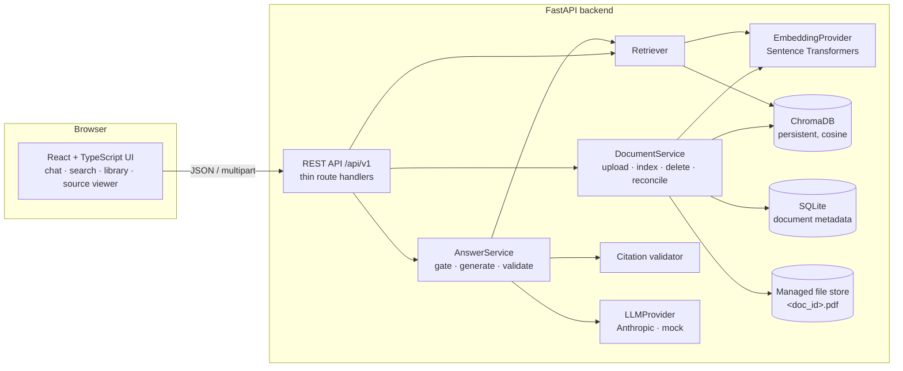
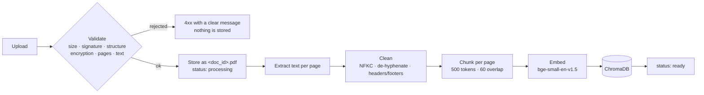
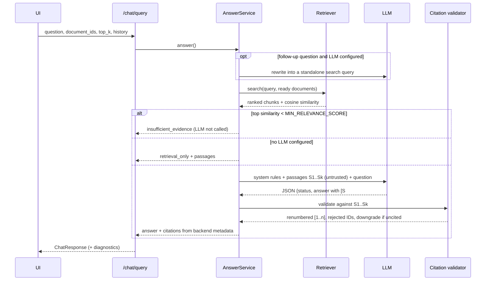

# Architecture

DocuMind is a FastAPI backend with an explicit, framework-free RAG pipeline and a
React single-page app. Every pipeline stage is a small module with a narrow
interface, so each one is tested on its own and can be replaced independently.

## Components



| Module | Responsibility | Depends on |
|---|---|---|
| `ingestion/pdf_parser.py` | Signature, structure, encryption, page-count and text checks; per-page extraction with pypdf | `cleaner` |
| `ingestion/cleaner.py` | Unicode normalisation, de-hyphenation, whitespace, removal of repeated headers/footers | — |
| `ingestion/chunker.py` | Token-aware, page-bounded chunks with character offsets and deterministic IDs | a `Tokenizer` |
| `ingestion/pipeline.py` | chunk → embed → index for one document; chunk-size guard | embedder, vector store |
| `embeddings/` | `EmbeddingProvider` protocol and the Sentence Transformers implementation | sentence-transformers |
| `vectorstore/chroma_store.py` | One collection per embedding model; add, query, filter, delete, count | chromadb |
| `documents/` | Document lifecycle and SQLite metadata (source of truth for status) | all of the above |
| `retrieval/retriever.py` | Query validation, query embedding, filtered similarity search | embedder, vector store |
| `generation/` | Prompts, LLM adapters, citation validation, answer orchestration | retriever, LLM |
| `evaluation/` | Benchmark dataset, metrics, baseline run and experiments | the production services |
| `api/` | HTTP layer: request validation, response models, error mapping | the services |

`container.py` wires the components together. Tests build the same container with
a fake embedder, an in-memory Chroma client or the mock LLM, without patching.

## Ingestion pipeline



Validation runs synchronously, so an invalid file is rejected in the upload
response. Chunking, embedding and indexing run as a background task; the UI polls
the document status (`processing` → `ready` or `failed`).

## Question answering



## Consistency and recovery

* **SQLite is the source of truth** for which documents exist and whether they are
  `ready`. Retrieval always filters by the current set of ready document IDs, so a
  half-indexed document can never contribute passages.
* **Deletion order** is vectors → metadata → file. If deleting vectors fails,
  nothing else changes. A file left behind by a later failure is harmless and is
  removed at the next startup.
* **Startup reconciliation** marks interrupted ingestions as failed, deletes orphan
  vectors and files, and **re-indexes documents whose embedding model, chunking
  configuration or ingestion pipeline version differs from the current one**.
* **One Chroma collection per embedding model** (`documind_<model>_<dim>`), with
  the model ID checked against the collection metadata on open. Vectors from
  different models are never compared.

## Data layout

```
data/
  demo/                 bundled sample PDFs + manifest.json + markdown sources
  runtime/              created at runtime (git-ignored, Docker volume)
    uploads/<doc_id>.pdf
    chroma/             persistent Chroma client
    documind.db         SQLite metadata
```

## Frontend

The React app keeps business logic out of components: API calls live in
`services/api.ts`, state in hooks (`useDocuments`, `useConversations`,
`usePreferences`), and components render. Conversations are stored in the
browser's localStorage; the backend is stateless and receives a bounded slice of
history with each question.
